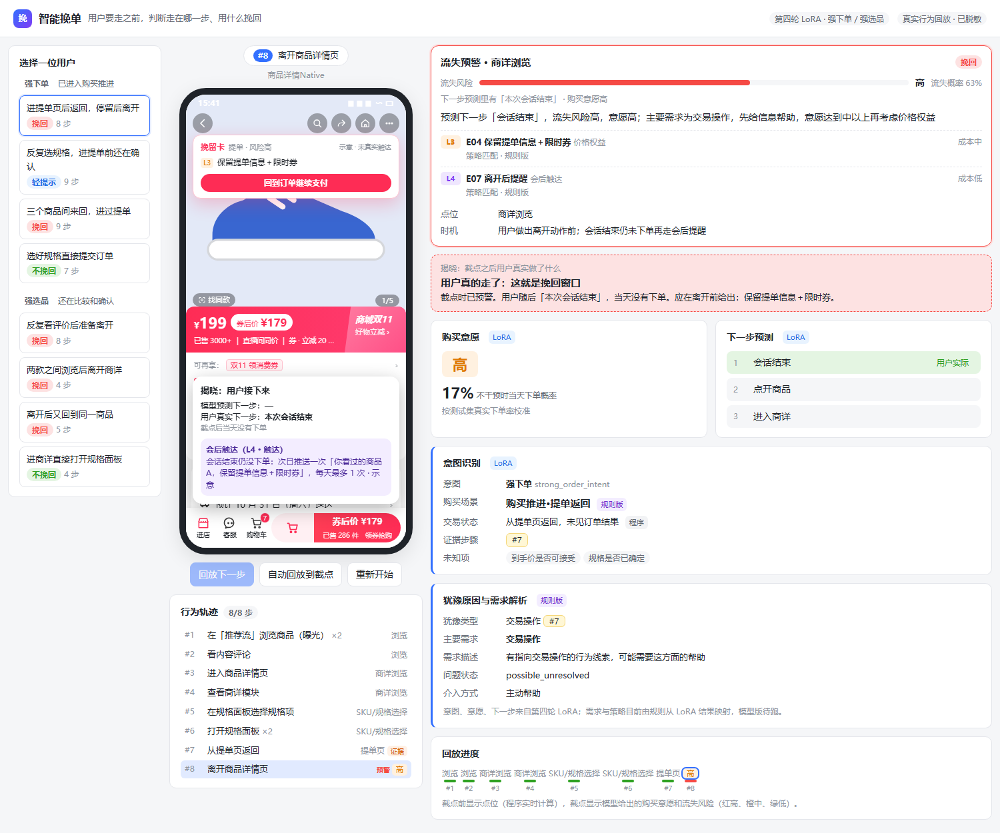
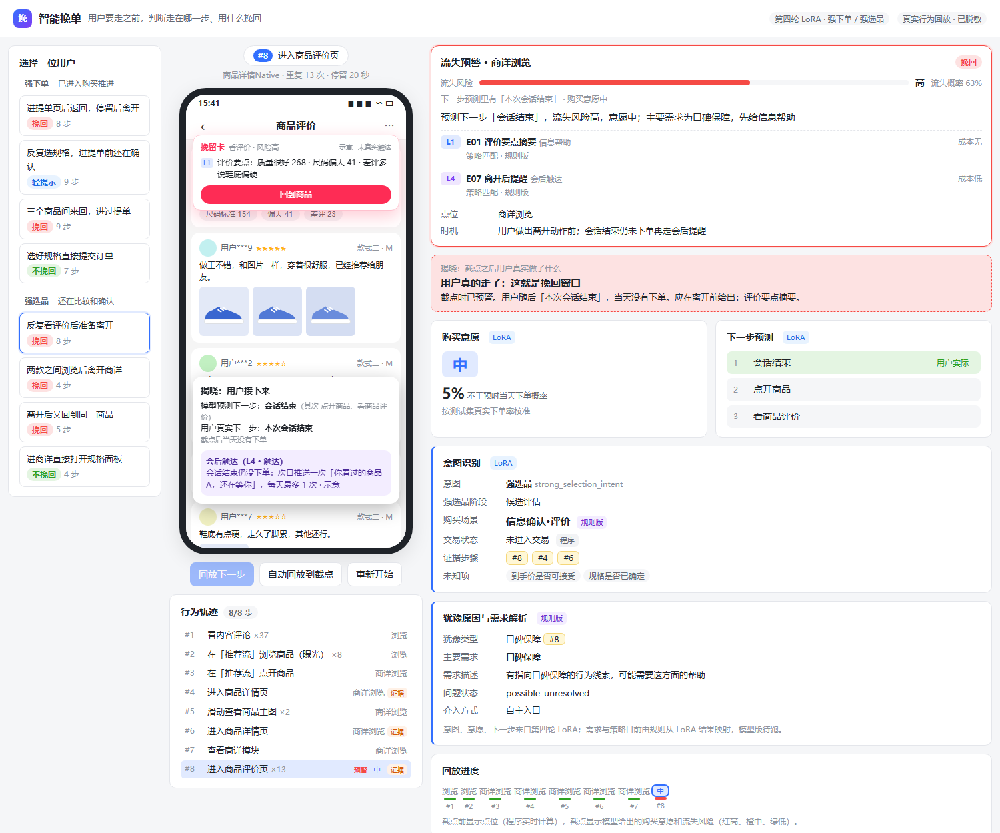
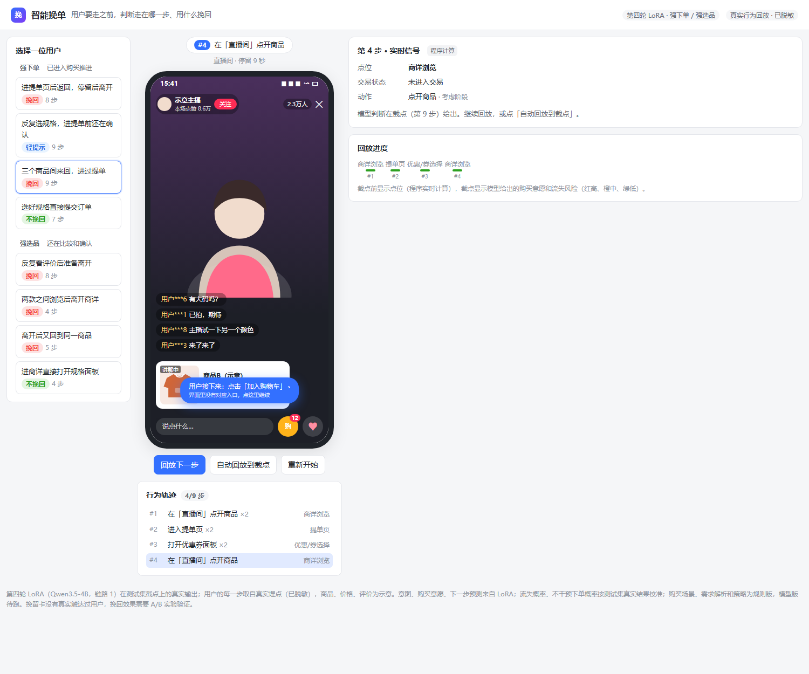

# demo-understand-your-mind-for-shopping · 第四轮

单文件静态页 `index.html`，不需要后端，页面里不调用模型。在原 demo（第三轮）的基础上，换成第四轮模型在测试集截点上的真实输出，只展示强下单、强选品两类意图。

## 演示什么

| # | 意图 | 案例 | 模型判断 | 真实结果 |
|---|---|---|---|---|
| 1 | 强下单 | 进提单页后返回，停留后离开 | 挽回：意愿高、风险高；E04 + E07 | 会话结束，当天未下单 |
| 2 | 强下单 | 反复选规格，进提单前还在确认 | 轻提示：适用／配置确认；E02 | 继续完成规格选择 |
| 3 | 强下单 | 三个商品间来回，进过提单 | 挽回：候选取舍；E08 | 回去点开商品 |
| 4 | 强下单 | 选好规格直接提交订单 | 不挽回：意愿很高，正常推进 | 下单成功 |
| 5 | 强选品 | 反复看评价后准备离开 | 挽回：口碑保障；E01 + E07 | 会话结束，当天未下单 |
| 6 | 强选品 | 两款之间浏览后离开商详 | 挽回：风险高；E07 | 商详无操作离开 |
| 7 | 强选品 | 离开后又回到同一商品 | 挽回：风险高；E07 | 会话结束，当天未下单 |
| 8 | 强选品 | 进商详直接打开规格面板 | 不挽回：意愿高、风险低 | 当天自己下单 |

8 个案例都来自第四轮测试集（测试用户训练时没见过），模型对这 8 个截点的下一步预测都是对的。案例是挑出来做演示的，整体准确率以评测报告为准。

## 页面怎么读

- **左侧：** 按意图分组，标签是该案例的处理结论：挽回、轻提示或不挽回。
- **中间：** 手机界面按用户真实的每一步回放，高亮下一步要点的位置。
- **右侧：**
  - 截点之前：显示程序实时算出的点位和交易状态。
  - 截点（最后一步）：显示第四轮模型的六项输出，即意图识别、购买场景、购买意愿、犹豫原因、下一步预测、需求解析，外加流失预警和挽回分档。
- **揭晓：** 回放到截点后，揭晓用户真实的下一步、当天是否下单。

## 字段来源

| 内容 | 来源 |
|---|---|
| 意图（5 类）、购买意愿、下一步预测、证据步骤、未知项 | 第四轮 LoRA（Qwen3.5-4B，链路 1） |
| 流失概率、不干预下单概率 | 按测试集真实结果校准：高 63%／中 28%／低 12%；很高 81%／高 17%／中 5%／低 2% |
| 点位、交易状态 | 程序从行为序列实时计算 |
| 购买场景、犹豫类型、需求解析、策略 E01–E10 | 规则版：由 LoRA 结果按规则映射，模型版待跑 |

## 局限

- 第四轮模型只在每个会话的截点判断一次，所以截点前没有逐步的模型判断。如果要做逐步预警，需要在 GPU 上对每一步分别推理。
- 手机界面的商品、价格、评价都是示意；挽留卡没有真实触达过用户，挽回效果需要 A/B 实验验证。

## 截图

| 案例 1 · 强下单 · 提单返回 | 案例 5 · 强选品 · 反复看评价 | 案例 3 · 截点前回放 |
|---|---|---|
|  |  |  |

## 部署

纯静态页面，无需构建。Vercel 导入本仓库，Framework 选 Other，Build Command 和 Output Directory 留空。地址后加 `#3` 打开第 3 个案例，`#3-5` 直接停在第 3 个案例的第 5 步。

第三轮版本（11 个案例）保留在 `main` 分支。
